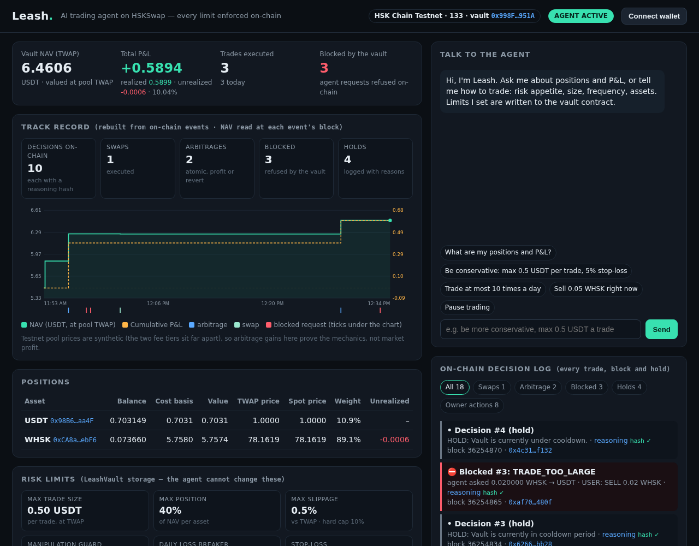
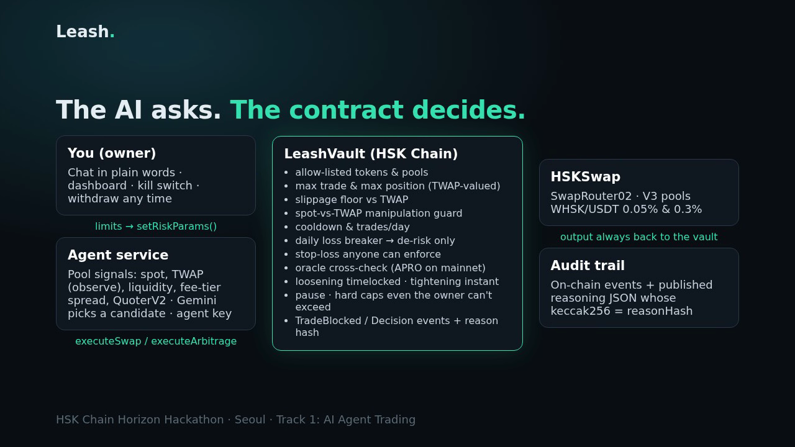
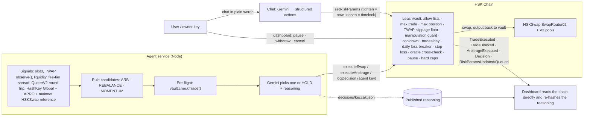

# Leash

**An AI trading agent for HSKSwap whose risk limits live in a smart contract the AI cannot override.**



   

Entry for the **HSK Chain Horizon Hackathon · Seoul, Track 1: AI Agent Trading**.

## For judges: 60-second summary

* **What it is.** An autonomous agent reads both HSKSwap WHSK/USDT pools, Gemini picks a trade (or holds) from rule-based candidates, and a vault contract on HSK Chain decides whether it happens.
* **Why it's different.** The vault **logs refused trades on-chain** (`TradeBlocked` with a reason code) instead of silently reverting. **Tightening a limit is instant, loosening is timelocked**, so a hijacked prompt can't widen the leash. Every decision carries a `reasonHash`, and the dashboard re-hashes the published reasoning to prove it matches the chain. Arbitrage is atomic: profit or revert.
* **Proof (HSK testnet, verified contract).** Vault [`0x998F…951A`](https://testnet-explorer.hskchain.net/address/0x998F3EAA037d74F328F4Fc300DB6C3C6bBB1951A) · autonomous arbitrage [0xf2c460ca…](https://testnet-explorer.hskchain.net/tx/0xf2c460ca566e2d7af649d9865912bc9f1da0e51a8b2e0f14684c5c43b022579f) · trade blocked on-chain [0xaf700637…](https://testnet-explorer.hskchain.net/tx/0xaf7006376f7f17e2d458039f5fcfba4adf19eed2cdb93e5d6c2416866c83480f) · loosening timelocked [0x22a53cc4…](https://testnet-explorer.hskchain.net/tx/0x22a53cc4009173d5c85f291a3a22bf797847e4c82877d8482f32b67758777e22) · kill switch [0xe7cf5fc7…](https://testnet-explorer.hskchain.net/tx/0xe7cf5fc7fada41bdb94d6efde0eebcb693742dfcb888cfe939159bc0949daa4d) · autonomous hold with reasoning [0xe58294b2…](https://testnet-explorer.hskchain.net/tx/0xe58294b26479ae5d4a0e5651a8d0940ad629d5dd1c5d84ad158dbd9b35cd58ce)
* **Maturity.** 34 Foundry tests (33 on a fork of the live HSK testnet pools, 1 mainnet dry run with APRO). Mainnet deploy script ready, not run.
* **HSK products used.** HSKSwap (SwapRouter02, QuoterV2, V3 pools, factory), HSK Blockscout verification, APRO oracle, HashKey Global market data, `@hskswap/sdk-core` addresses.
* **Honest limits.** Testnet pool prices are synthetic, so gains shown are mechanics, not market profit. The track record is a small testnet run, not a backtest. Not audited.

**Quickstart (one command, no keys):**

```bash
git clone https://github.com/Mofofk/leash-hsk-agent && cd leash-hsk-agent && ./quickstart.sh
```

It installs `forge-std`, builds and runs the 34 tests, then serves the read-only dashboard at `http://localhost:8080/dashboard/`. To run the agent itself, see [Run it](#run-it).

| | |
|---|---|
| **Network** | HSK Chain testnet (chain 133). Mainnet (177) deploy script prepared, not run |
| **Vault (v3, live)** | [`0x998F3EAA037d74F328F4Fc300DB6C3C6bBB1951A`](https://testnet-explorer.hskchain.net/address/0x998F3EAA037d74F328F4Fc300DB6C3C6bBB1951A) · source verified on HSK Blockscout |
| **DEX** | HSKSwap: SwapRouter02, QuoterV2 and the WHSK/USDT 0.05% and 0.3% pools |
| **AI** | Google Gemini (AI Studio) picks between rule-based candidates and runs the chat |
| **Tests** | `cd contracts && forge test`: 34 tests, 33 on a fork of the live HSK testnet pools plus 1 mainnet dry run with the APRO oracle |
| **Demo video** | `docs/Leash_HSK_demo.mp4` (2:46, captioned) |

---

## Why it's different

Several Track 1 teams use the same base pattern: a vault that only lets an agent swap within limits. Here is what Leash adds, compared with what the other teams' public READMEs and BUIDL pages describe.

| | **Leash** | Kedia | hsk-pilot | Salts |
|---|---|---|---|---|
| Who owns the limits | The user. The agent key is a separate, revocable address | The user | The user, per session | The agent's own wallet owns the vault (stated in their notes) |
| Refused trades | **Logged on-chain** as `TradeBlocked(code, reasonHash)`. Nothing is silently reverted | Vault reverts | Guard reverts | Vault refuses |
| Loosening a limit | **Timelocked on-chain** (10 min testnet, 1 h mainnet). Tightening is instant. The owner can cancel | Owner signs changes | Set once per session | Changed by asking the agent |
| Stop-loss | **On-chain**, and **anyone** can enforce it (`triggerStopLoss`) | Shown in the UI | n/a | Plain text kept in the agent's memory |
| Valuation | Pool **TWAP** via `observe()`, plus a spot-vs-TWAP manipulation guard | HSKSwap vs HashKey Exchange gap | Rebalancing guard | Pool price |
| Arbitrage | **Atomic** cross-fee-tier round trip that reverts unless it ends in profit | CEX–DEX gap | – | – |
| Daily loss | NAV circuit breaker that then allows only de-risking | Daily limits | Session limits | Daily limit |
| Oracle cross-check | APRO feeds (listed in the HSK Chain docs). Fails closed if a feed is stale or not whitelisted | – | – | – |
| Audit trail | Each decision's full JSON is published. Its keccak256 equals the on-chain `reasonHash`, and the dashboard re-hashes and verifies it | Reasoning shown in the UI | Evidence files | Transaction history |
| Chat → limits | The chat's sentence is stored on-chain with the change (`RiskParamsUpdated.instruction`) | Plain-English control | – | Plain-text strategy |

**What we learned building it (and why v3 exists).** On the v2 vault, a user said "sell 0.05 WHSK right now". To make the order fit, the chat model raised the trade limit from 0.5 to 4 USDT on its own ([tx](https://testnet-explorer.hskchain.net/tx/0x03065b8af93922bcba0610826f30569de72ebb6b82a04fb9436b15705cf8eb1e)). That is exactly the failure an "agent on a leash" design has to stop. So v3 makes any loosening wait behind an on-chain timelock, and the chat prompt forbids changing limits on a trade request. In the v3 demo, the same request is [blocked on-chain](https://testnet-explorer.hskchain.net/tx/0x269ad66d985ffb13ee9ba44f1236de3ccff77870587f7bc7a2d25b1037e6211b). When the user does ask for a bigger limit, the change is [queued, not applied](https://testnet-explorer.hskchain.net/tx/0x22a53cc4009173d5c85f291a3a22bf797847e4c82877d8482f32b67758777e22).

---

## Architecture





**The contract does the enforcing:** `contracts/src/LeashVault.sol`

* **Roles.** The owner (the user) sets limits, allow-lists pools and tokens, pauses, withdraws, and revokes or rotates the agent. The agent can only call `executeSwap`, `executeArbitrage`, `logDecision` and `pause`. It has no way to move funds out: swap output is hard-wired to come back to the vault, and only the owner can withdraw.
* **Checks on every request** (`checkTrade`, also callable as a dry run):
  * paused
  * token and pool allow-lists (pools must be real HSKSwap factory pools)
  * balance
  * **max trade value at TWAP**
  * cooldown
  * trades per day
  * **spot-vs-TWAP deviation** (manipulation guard)
  * **slippage floor = TWAP-expected output × (1 − max slippage)**, which overrides whatever minimum the agent sends
  * **APRO/Chainlink-style oracle cross-check and stablecoin depeg guard**
  * max position (% of NAV)
  * **daily NAV loss breaker**: after it trips, only trades into the quote token are allowed
  * stop-loss (no buying more of a position that has hit its stop)
* **Hard caps that bind even the owner:** slippage ≤ 10%, deviation ≤ 20%, daily loss ≤ 50%, stop-loss between 0.5% and 50% (or off), TWAP window between 60 s and 3600 s, at most 500 trades a day.
* **Accounting on-chain:** cost basis per token, realized P&L, NAV at TWAP, unrealized P&L (`pnl()`, `position()`, `nav()`).
* **Atomic arbitrage:** `executeArbitrage` sells on one fee tier and buys back on another inside a self-call. If the round trip doesn't return `minProfitBps` more, everything reverts and the attempt is logged as `ARB_UNPROFITABLE`.

**The agent decides:** `agent/src`

* `signals.js` reads both HSKSwap WHSK/USDT pools: `slot0`, 5- and 30-minute TWAPs from `observe()`, liquidity, and the fee-tier spread. It quotes the exact round trip through HSKSwap's **QuoterV2**, and reads reference prices for HSK: the mainnet HSKSwap pool, the **HashKey Global** exchange ticker and the **APRO HSK/USD** oracle.
* `agent.js` builds candidates from fixed rules (arbitrage edge, rebalance toward your target weight, momentum against the TWAP) and pre-flights each one against `vault.checkTrade`. **Gemini** then picks one or HOLD and writes the reasoning. The full JSON is saved as `decisions/<keccak256>.json` and its hash is sent on-chain with the trade. If the LLM is down, a deterministic fallback takes over.
* `chat.js` turns plain words ("be conservative, max 0.5 USDT a trade, 5% stop-loss", "trade at most 10 times a day", "pause") into structured actions: risk limits, preferences, asset allow-list, pause/resume, trade now, run a cycle. Owner actions are signed by the owner key.

**The dashboard shows it:** `dashboard/index.html`

A static page that reads HSK Chain directly, with no wallet needed: a **track record** rebuilt from on-chain events (counts of decisions, swaps, arbitrages, blocks and holds) with a **NAV and cumulative P&L chart** read from the vault at each event's block, NAV, P&L, positions, live limits, any queued loosening, market signals, and the on-chain decision log, where each entry's reasoning file is re-hashed in the browser (✓), filterable by kind. It works on mobile and shows loading and RPC-error states. You can connect a wallet to switch to chain 133; the owner gets kill-switch buttons. Chat works when the local agent is running.

---

## Live on HSK Chain testnet

| What | Link |
|---|---|
| LeashVault v3 (verified) | [0x998F3EAA037d74F328F4Fc300DB6C3C6bBB1951A](https://testnet-explorer.hskchain.net/address/0x998F3EAA037d74F328F4Fc300DB6C3C6bBB1951A) |
| Owner (user) | [0xf166119dF7F534B10029119650EEb93Aba5c9b1e](https://testnet-explorer.hskchain.net/address/0xf166119dF7F534B10029119650EEb93Aba5c9b1e) |
| Agent key | [0x1C7892F259EC084C45EDBEea9cDb2664A4eb81Ff](https://testnet-explorer.hskchain.net/address/0x1C7892F259EC084C45EDBEea9cDb2664A4eb81Ff) |
| HSKSwap SwapRouter02 / QuoterV2 / Factory | `0xa6914E66690c6794244B5f66a09eAEbf66254237` / `0x73820d9eE5Bf1BfcD429580320FC7A374E8fa1cC` / `0x2dC2c21D1049F786C535bF9d45F999dB5474f3A0` |
| WHSK / USDT (testnet) | `0xCA8aAceEC5Db1e91B9Ed3a344bA026c4a2B3ebF6` / `0x98B6173A8B7DFc52ce8bc88f1184a918A1CCaa4F` |
| WHSK/USDT pools 0.05% / 0.3% | `0xff2b7E501C870980Bf5641B4a70D0F9fb0f6f6ab` / `0xc076FB478b77633736738579c7f48D2539604a50` |

**Transactions to check (v3):**

| Event | Tx |
|---|---|
| ⇄ Autonomous arbitrage picked by Gemini in the agent loop | [0xf2c460ca…579f](https://testnet-explorer.hskchain.net/tx/0xf2c460ca566e2d7af649d9865912bc9f1da0e51a8b2e0f14684c5c43b022579f) |
| • Autonomous hold, logged with a reasoning hash (vault in cooldown) | [0xe58294b2…58ce](https://testnet-explorer.hskchain.net/tx/0xe58294b26479ae5d4a0e5651a8d0940ad629d5dd1c5d84ad158dbd9b35cd58ce) |
| ⛔ Oversized chat order blocked (`TRADE_TOO_LARGE`, 0.02 WHSK ≈ 1.56 USDT vs 0.5 limit) | [0xaf700637…480f](https://testnet-explorer.hskchain.net/tx/0xaf7006376f7f17e2d458039f5fcfba4adf19eed2cdb93e5d6c2416866c83480f) |
| ✓ Trade executed (`executeSwap`, 0.004 WHSK → 0.3125 USDT, TWAP floor enforced) | [0x425e25ee…1e16](https://testnet-explorer.hskchain.net/tx/0x425e25eed1e3e69df8dd50c813a591b060285ddc60768d9752f52150057c1e16) |
| ⇄ Atomic arbitrage (0.0115 → 0.0165 WHSK across fee tiers) | [0x2774bc3e…6e07](https://testnet-explorer.hskchain.net/tx/0x2774bc3ea9588b946ebd8dd0bdeccdf7b8ed13097698736f89caab4bf6bb6e07) |
| ⛔ Trade blocked on-chain: `TRADE_TOO_LARGE` | [0x269ad66d…211b](https://testnet-explorer.hskchain.net/tx/0x269ad66d985ffb13ee9ba44f1236de3ccff77870587f7bc7a2d25b1037e6211b), [0xe90c2340…9ced](https://testnet-explorer.hskchain.net/tx/0xe90c23405ed7806d37146275eb04506f1ab23fef981c744cc0172e35b1779ced) |
| ⚙ Limits tightened from chat (instant) | [0x9ce7272d…0a0a](https://testnet-explorer.hskchain.net/tx/0x9ce7272dc67a74d4b99f3e4af19e46f305e7b8b079e8450f27159885a8270a0a) |
| ⏳ Loosening request queued behind the timelock | [0x22a53cc4…7e22](https://testnet-explorer.hskchain.net/tx/0x22a53cc4009173d5c85f291a3a22bf797847e4c82877d8482f32b67758777e22) |
| ✕ Owner cancels the queued loosening | [0x9996cab9…a682](https://testnet-explorer.hskchain.net/tx/0x9996cab93a9ed2df255edea1678b29678dfed7922a336a3d7a27b8432c50a682) |
| ■ Kill switch: paused, then ▶ resumed | [0xe7cf5fc7…aa4d](https://testnet-explorer.hskchain.net/tx/0xe7cf5fc7fada41bdb94d6efde0eebcb693742dfcb888cfe939159bc0949daa4d), [0x7a6c2c8a…fd5b](https://testnet-explorer.hskchain.net/tx/0x7a6c2c8a4dbf9e2a3b5360823d52c8a5e025e0fcb46eaaa1ef25291c6382fd5b) |

Earlier versions, kept for history: v1 [`0x92cB…8a68`](https://testnet-explorer.hskchain.net/address/0x92cB092B846804d92a45E64772bf7114a9D48a68) (first arbitrage fills, e.g. [0x194545fa…](https://testnet-explorer.hskchain.net/tx/0x194545fa7a7434a78c08c573d7a22d6dbccd8e25933cd9822ad7e74a9f1c14c6)) and v2 [`0x1028…8816`](https://testnet-explorer.hskchain.net/address/0x1028D51b8302186B531CEEa35b87eaD2F71e8816) (the incident described above). The funds were moved to v3 by owner withdrawals and deposits.

> Testnet pool prices are synthetic. On testnet WHSK trades near 78 USDT in the 0.05% pool and 54 USDT in the 0.3% pool, while the real HSK price is about $0.08. That spread is real on-chain state, and the arbitrage fills are real swaps against it, but we claim no market profit.

---

## Run it

Requirements: Foundry, Node 20+.

```bash
git clone https://github.com/Mofofk/leash-hsk-agent && cd leash-hsk-agent
cp .env.example .env          # DEPLOYER_PK (owner), AGENT_PK, GEMINI_API_KEY  (testnet keys only)

# contracts
cd contracts
forge install foundry-rs/forge-std --no-git   # or: git submodule update --init
forge test                                    # 34 tests; forks the live HSK testnet + a mainnet dry run
forge script script/Deploy.s.sol --rpc-url hsk_testnet --broadcast \
  --verify --verifier blockscout --verifier-url https://testnet-explorer.hskchain.net/api/
# put the new vault address + block in ../deployments.json, then deposit:
cast send <vault> "depositNative()" --value 0.05ether --private-key $DEPLOYER_PK --rpc-url https://testnet.hsk.xyz

# agent + dashboard
cd ../agent && npm install
npm start                     # dashboard + chat on http://localhost:8787
npm run auto                  # same, plus an autonomous cycle every prefs.loopSeconds
npm run cycle                 # one observe → decide → execute cycle
npm run chat -- "be conservative, max 0.5 USDT a trade"
```

You can host the dashboard as a static page (it reads the chain directly). For chat, run the agent and open `dashboard/index.html?agent=http://localhost:8787`.

### Mainnet (prepared, not run)

`contracts/script/DeployMainnet.s.sol` deploys to HSK Chain mainnet (177). It wires up HSKSwap mainnet (factory `0x972cA9D1…c742`, SwapRouter02 `0x2c16f75b…D8F3`), WHSK `0xB210D212…1Cf1`, USDT (6 decimals) `0xF1B50eD6…9029`, the WHSK/USDT 0.3% pool, a **1-hour loosening timelock**, and the **APRO HSK/USD and USDT/USD** feeds as the oracle cross-check and depeg guard. `test/MainnetDryRun.t.sol` simulates the full deployment and a swap on a local mainnet fork. It also shows that APRO's feeds are access-controlled for contracts, so the vault **fails closed** until APRO whitelists it.

```bash
forge script script/DeployMainnet.s.sol --rpc-url hsk_mainnet --broadcast \
  --verify --verifier blockscout --verifier-url https://hsk.blockscout.com/api/
```

## HSK Chain products used

* **HSKSwap**: SwapRouter02 for execution, QuoterV2 for the exact round-trip quotes behind the arbitrage signal, V3 pools (`slot0`, `observe`, `liquidity`) for TWAPs and the manipulation guard, and the factory to check pools are genuine
* **HSK Chain testnet** with the official faucet; contracts verified on **HSK Blockscout**
* **APRO oracle** (listed in the HSK Chain oracle docs): HSK/USD and USDT/USD cross-check on mainnet; read live on the dashboard
* **HashKey Global** public market data as the CEX reference for the CEX–DEX spread
* `@hskswap/sdk-core` address registry, used as the source of all the HSKSwap addresses above
* The owner can be a **Safe** on HSK Chain (any address works as `owner`)

## Tests

```
LeashVaultForkTest (29, forks live HSK testnet HSKSwap pools)
  TickMath vs live pool · deposit at TWAP · sell with TWAP floor · agent's zero min-out replaced by the floor
  blocks: trade too large · token not allowed · pool not allowed · cooldown & frequency · position limit
  kill switch (owner can still withdraw; agent can't unpause) · agent can self-pause · revoked agent locked out
  agent has no path to funds or limits · hard caps bind the owner · fake pools rejected
  manipulation: a whale dump trips the spot-vs-TWAP guard
  stop-loss: anyone can enforce it after a crash · respects the kill switch · blocks buying a losing position
  daily loss breaker: de-risk only, then resets the next day
  oracle: agrees → trades · disagrees → ORACLE_DEVIATION · stale → ORACLE · USDT depeg → STABLE_DEPEG
  atomic arbitrage across fee tiers is profitable; the wrong direction reverts and is logged
  withdrawals keep P&L honest · fuzz: TWAP floor always holds (256 runs)
LeashVaultTimelockTest (4): tighten instantly · loosen timelocked · owner cancels · stop-loss off = loosening
MainnetDryRun (1): mainnet fork deploy + APRO cross-check (fails closed without access) + swap
```

## Repo layout

```
contracts/   Foundry: src/LeashVault.sol, lib/ (TickMath, FullMath, PoolOracle), test/, script/
agent/       Node agent: signals, strategy + Gemini, executor, chat, HTTP server
dashboard/   Static dashboard (ethers v6, vendored)
decisions/   Published reasoning JSON, named by the on-chain reasonHash
deployments.json  All addresses (testnet live, mainnet prepared)
docs/        BUIDL write-up, demo video, images
```

## Security notes

* Not audited. Testnet keys only. `.env` is git-ignored and never committed.
* The demo server holds the owner key so that chat can sign limit changes. In production, the owner signs in their own wallet (the dashboard already supports pause/resume this way). Because loosening is timelocked, even a leaked owner session can't widen the leash instantly.
* APRO feeds on mainnet need the vault to be whitelisted by APRO. Until then the oracle check fails closed.

## Team

Ajay Kumar (India) · X [@coolajay0099](https://x.com/coolajay0099) · Telegram Coolboi0099

MIT License.
